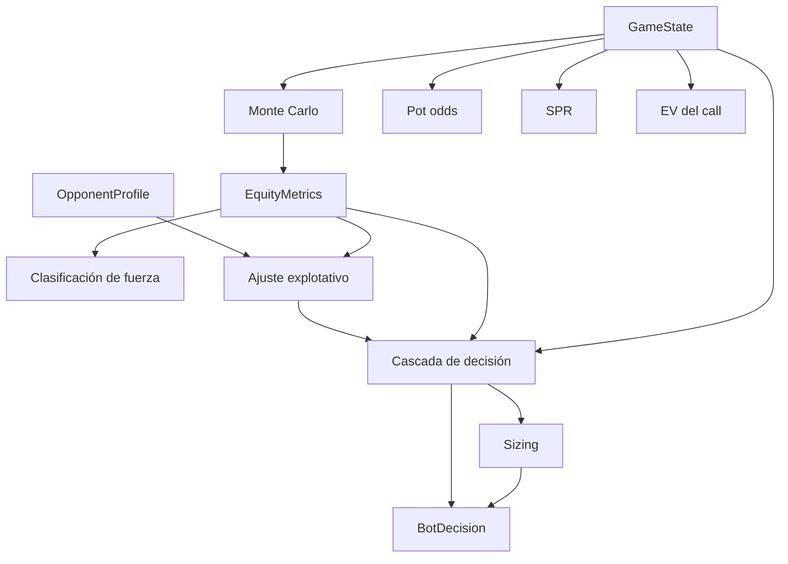

# Algoritmos

Catálogo de los algoritmos que toman decisiones o calculan números en el
sistema. Cada ficha indica **dónde vive**, **para qué se usa**, **qué recibe**,
**qué devuelve** y **qué límites tiene**. Los helpers triviales (`parse_card`,
getters) no se documentan.

Regla de mantenimiento: los umbrales y fórmulas viven **solo aquí**. Si cambian
en el código, se actualiza esta página.

## A. Orden de aplicación del pipeline

1. El tracker entrega `OpponentProfile` (fichas 8–10).
2. El motor calcula `EquityMetrics` (fichas 3–7).
3. La inferencia ajusta umbrales (ficha 11).
4. La cascada elige acción (ficha 12) y la dimensiona (ficha 13).

## 1. Evaluación de manos (5–7 cartas)

- **Ubicación:** `poker_bot/card_evaluator.py` → `evaluate_5card`, `evaluate_hand`
- **Propósito:** comparar la fuerza de dos manos en showdown.
- **Entradas:** lista de cartas ya parseadas `(rank 0–12, suit 0–3)`.
- **Salidas:** `(categoría 0–8, lista de desempates)`; tuplas comparables.
- **Cómo funciona:** con 5 cartas detecta color (un solo palo), escalera (5 rangos
  únicos consecutivos, incluida la rueda A-2-3-4-5 con alta = 5) y frecuencia de
  rangos (póker, full, trío, doble pareja, pareja). Con 6–7 cartas enumera las
  `C(n,5)` combinaciones (máximo 21) y se queda con la mejor.
- **Coste:** O(C(n,5)) por evaluación; se llama una vez por jugador y simulación.
- **Límites:** sin *kickers* por palo, sin cartas comodín; es Python puro, no
  busca rendimiento extremo.

## 2. Chen score preflop

- **Ubicación:** `poker_bot/heuristic_engine.py` → `evaluate_preflop_chen_score`
- **Propósito:** estimación de fuerza preflop, usada **solo como fallback**
  cuando el Monte Carlo no completa ninguna simulación.
- **Entradas:** 2 cartas como strings (`["Ah", "Kd"]`).
- **Salidas:** `float` normalizado 0.0–1.0 (puntuación Chen / 20, acotada).
- **Cómo funciona:** valor de la carta alta (A=10, K=8, Q=7, J=6, T=5, resto
  `(rank+2)/2`); pareja duplica con mínimo 5 (55 = 6); suited +2; penalización
  por hueco (−1, −2, −4, −5); bonus +1 para conectores bajos.
- **Límites:** es una aproximación histórica, no equity real; no considera
  número de rivales ni posición.

## 3. Equity por Monte Carlo

- **Ubicación:** `poker_bot/heuristic_engine.py` → `estimate_range_weighted_monte_carlo`
- **Propósito:** probabilidad de ganar o empatar en showdown.
- **Entradas:** `hole_cards`, `community_cards`, `num_active_opponents`,
  `opponent_vpip_filter`, `cancel_event`, `max_duration_sec`.
- **Salidas:** `(equity 0.0–1.0, simulaciones_ejecutadas)`.
- **Cómo funciona:** quita las cartas conocidas del mazo y, por cada simulación,
  reparte sin reemplazo las cartas que faltan del board y 2 por rival; evalúa
  todas las manos y suma 1.0 si gana, `1/n` si empata con `n` manos. Itera en
  lotes de `batch_size`, comprobando cancelación y tiempo **entre lotes**.
- **Presupuesto:** hasta `default_iterations` (12 000 en vivo, 4 000 en replay,
  1 500 con `--fast`) o `max_duration_sec` (3.8 s en vivo).
- **Límites:** `opponent_vpip_filter` **se recibe pero no se usa**: los rivales
  reciben manos aleatorias, así que no es *range-weighted* pese al nombre. La
  comprobación de tiempo es por lote, por lo que puede pasarse hasta un lote.

## 4. Pot odds

- **Ubicación:** `poker_bot/heuristic_engine.py` → `calculate_pot_odds`
- **Entradas:** `to_call`, `pot`.
- **Salida:** `to_call / (pot + to_call)`; 0.0 si no hay nada que pagar.
- **Uso:** equity mínima para que un call sea EV ≥ 0; es la base del umbral de
  call antes de ajustes explotativos.
- **Límites:** asume que el `pot` recibido no incluye el `to_call` (así lo
  construyen el loader y el bridge).

## 5. SPR (Stack-to-Pot Ratio)

- **Ubicación:** `poker_bot/heuristic_engine.py` → `calculate_spr`
- **Entradas:** `effective_stack`, `pot`.
- **Salida:** `stack / max(1, pot)`.
- **Uso:** detectar compromiso con el bote: con SPR < 1.8 y equity alta se
  empuja all-in.
- **Límites:** usa el stack del héroe, no el mínimo de los stacks (no es
  estrictamente "efectivo" en mesas multiway).

## 6. EV del call

- **Ubicación:** `poker_bot/heuristic_engine.py` → `evaluate_state`
- **Entradas:** `equity`, `pot`, `to_call`.
- **Salida:** `equity * (pot + to_call) - to_call`.
- **Uso:** se guarda en `EquityMetrics.expected_value_call` con fines de
  diagnóstico; la cascada decide con equity y pot odds, no con este valor.
- **Límites:** EV de una sola calle, sin implied odds ni fold equity.

## 7. Clasificación de fuerza

- **Ubicación:** `poker_bot/heuristic_engine.py` → `evaluate_state`
- **Entradas:** `equity`.
- **Salida:** `MONSTER` ≥ 0.75 · `STRONG` ≥ 0.58 · `MEDIUM` ≥ 0.42 ·
  `DRAW` ≥ 0.28 · `TRASH` < 0.28.
- **Uso:** etiqueta informativa en `EquityMetrics`; **no** modifica la decisión.

## 8. Métricas derivadas del tracker (SQL)

- **Ubicación:** `poker_bot/exploitative_tracker.py` → vista `v_opponent_profiles`
- **Entradas:** filas de `hand_participants` y `hand_actions`.
- **Salidas por jugador:** `vpip`, `pfr`, `three_bet_pct`, `aggression_factor`,
  `aggression_freq`, `postflop_fold_freq`, `wtsd`.
- **Fórmulas:**
  - `vpip = vpip_count / hands_observed`
  - `pfr = pfr_count / hands_observed`
  - `AF = postflop_bets_raises / max(1, postflop_calls)`
  - `fold_freq = postflop_folds / (bets_raises + calls + folds)`
  - `wtsd = wtsd_count / saw_flop_count`
- **Uso:** materia prima del perfilado; se calcula en SQL para que la lectura
  sea O(1) con índices.
- **Límites:** `three_bet_*`, `saw_flop_flag`, `went_to_showdown_flag` y
  `wtsd_count` **nunca se actualizan** en el código actual → `three_bet_pct` y
  `wtsd` quedan `NULL` (ver § C).

## 9. Smoothing bayesiano y confianza

- **Ubicación:** `poker_bot/exploitative_tracker.py` → `get_profiles_for_table`
- **Entradas:** media muestral de VPIP/PFR/AF/fold, `n` manos observadas.
- **Salidas:** las cuatro medias suavizadas y `confidence_weight`.
- **Cómo funciona:**
  - `suave = (media * n + prior * K) / (n + K)` con `K = 15`.
  - Priors: VPIP 0.24, PFR 0.16, AF 1.50, fold 0.45.
  - `confidence_weight = min(1, n / 50)`.
- **Uso:** evita conclusiones con pocas manos; el peso escala todos los ajustes
  explotativos.
- **Límites:** no suaviza el 3-bet; sin filas en la BD devuelve el prior con
  `weight = 0` y arquetipo `UNKNOWN`.

## 10. Clasificación de arquetipo

- **Ubicación:** `poker_bot/exploitative_tracker.py` → `classify_archetype`
- **Entradas:** `n` manos, VPIP, PFR, AF (ya suavizados).
- **Salida:** `NIT`, `TAG`, `LAG`, `CALLING_STATION`, `MANIAC` o `UNKNOWN`.
- **Reglas, en orden:**
  1. `n < 12` → `UNKNOWN`
  2. `vpip < 0.17 and pfr < 0.13` → `NIT`
  3. `0.17 ≤ vpip ≤ 0.27 and 0.13 ≤ pfr ≤ 0.22` → `TAG`
  4. `vpip > 0.35 and pfr < 0.14` → `CALLING_STATION`
  5. `vpip > 0.40 and pfr > 0.28 and af > 2.5` → `MANIAC`
  6. `vpip > 0.27` → `LAG`
  7. si no → `UNKNOWN`
- **Uso:** selecciona la rama de ajuste explotativo.
- **Límites:** el orden importa (una estación con PFR bajo cae en 4 antes que en
  5); hay huecos que terminan en `UNKNOWN` aunque haya muestra suficiente.

## 11. Ajuste explotativo de umbrales

- **Ubicación:** `poker_bot/inference_engine.py` → `compute_exploitative_adjustments`
- **Entradas:** `metrics.pot_odds`, arquetipo, `confidence_weight = w`.
- **Salidas:** `(required_call_equity, value_bet_threshold, bluff_freq)`.
- **Base:** `req_call = pot_odds`, `value = 0.58`, `bluff = 0.20`.

| Arquetipo | `req_call` | `value_bet_threshold` | `bluff_freq` |
|---|---|---|---|
| `NIT` | `+0.10·w` | `+0.05·w` | `+0.35·w` |
| `CALLING_STATION` | `−0.05·w` | `−0.10·w` | `0.0` |
| `MANIAC` | `−0.08·w` | `−0.04·w` | `0.05` |
| `TAG` | sin cambio | `0.55` | `0.15` |
| `LAG` / `UNKNOWN` | sin cambio | sin cambio (0.58) | sin cambio (0.20) |

`req_call` se acota a un mínimo de 0.05.
- **Límites:** LAG y UNKNOWN no tienen rama propia; la cascada de bluff exige
  `bluff_freq ≥ 0.30`, umbral que solo alcanza NIT (necesita `w > 0.286`).

## 12. Cascada de decisión

- **Ubicación:** `poker_bot/inference_engine.py` → `_resolve_action`
- **Entradas:** `GameState`, `EquityMetrics`, `OpponentProfile`, los tres
  umbrales de la ficha 11.
- **Salida:** `BotDecision`.
- **Orden de evaluación (la primera que cumple gana):**
  1. **All-in / monstruo:** `(SPR < 1.8 and equity ≥ 0.65) or equity ≥ 0.85`
     → `RAISE` por `max_raise` si es legal.
  2. **Value bet:** `equity ≥ value_bet_threshold` → `RAISE` con sizing; si el
     sizing no es legal y hay que pagar, `CALL`.
  3. **Bluff explotativo:** `puede_check and equity ≥ 0.35 and bluff_freq ≥ 0.30`
     → `RAISE` con sizing de bluff.
  4. **Enfrentando apuesta:** `equity ≥ required_call_equity` → `CALL`; si no,
     `FOLD`.
  5. **Por defecto:** `CHECK`.
- **Límites:** no hay aleatorización (el bluff es determinista); `ALL_IN` nunca
  se emite como acción, se representa como `RAISE` por `max_raise`.

## 13. Sizing de apuesta

- **Ubicación:** `poker_bot/inference_engine.py` → `calculate_optimal_bet_sizing`
- **Entradas:** `GameState`, arquetipo rival, `is_value`.
- **Salida:** entero de fichas.
- **Cómo funciona:**
  - Preflop: `3 * big_blind + to_call`.
  - Postflop value: `to_call + 80% del pot` contra `CALLING_STATION`, `60%` en
    el resto.
  - Bluff: `to_call + 40% del pot`.
  - Acota a `[min_raise, max_raise]` con `max(min_raise, min(target, max_raise))`.
- **Límites:** si `min_raise > max_raise` el resultado puede superar `max_raise`;
  la cascada (paso 2) exige después `sizing ≤ max_raise` y cae a `CALL`/`CHECK`.

## 14. Reconstrucción de snapshots (shadow replay)

- **Ubicación:** `poker_benchmark/parquet_loader.py` → `iter_snapshots`
- **Entradas:** `matches.parquet`, `hands.parquet`, `actions.parquet` y los
  filtros `max_matches`, `max_decisions`, `target_agent`.
- **Salidas:** secuencia de `DecisionSnapshot` (estado crudo + acción real del
  LLM + resultado de la mano).
- **Cómo funciona:** recorre matches → manos → acciones ordenadas por
  `action_idx`. Mantiene `total_committed` y `street_committed` por asiento:
  - `pot_before = total_committed[0] + total_committed[1]`
  - `to_call = max(0, street_committed[rival] − street_committed[yo])`
  - stacks restantes = `stack_inicial − total_committed`
  - board visible según fase: 0 / 3 / 4 / 5 cartas
  - `min_raise = max(big_blind, to_call * 2)`
  Emite snapshot **antes** de aplicar la acción y solo si no es una ciega
  forzada (`post_small_blind`, `post_big_blind`).
- **Invariante:** el histórico que se pasa al bot contiene solo acciones
  anteriores; las cartas del rival se guardan aparte y nunca entran en el estado.
- **Límites:** `min_raise` es una aproximación (la subida mínima real depende de
  la última subida); `max_matches` toma el orden físico del Parquet.

## 15. Agregación del informe

- **Ubicación:** `poker_benchmark/shadow_evaluator.py` → `ShadowBenchmarkReport`
- **Entradas:** pares `(DecisionSnapshot, BotDecision)`.
- **Salidas:** latencias, matriz de confusión `LLM → bot`, *good folds*,
  *value raises*, perfiles.
- **Cómo funciona:**
  - `action_matrix[accion_llm][accion_bot] += 1`.
  - *Good fold*: el LLM hizo `CALL`/`RAISE`, el bot `FOLD`, ganó el rival y
    `to_call > 0` → suma `to_call` a fichas salvadas.
  - *Value raise*: el bot hizo `RAISE` y el agente LLM ganó la mano.
  - Percentiles: ordena y toma el índice `int(n · 0.95)` / `int(n · 0.99)`,
    acotado al último elemento.
- **Límites:** la matriz mide **coincidencia**, no acierto; *value raise* no
  comprueba que el raise fuera correcto, solo que la mano se ganó; los
  percentiles son aproximados (sin interpolación).

## 16. Dummy brain (demo de la TUI)

- **Ubicación:** `poker_tui/backend_bridge.py` → `DummyBrainBackend`
- **Propósito:** probar la reactividad y los colores de la TUI sin cargar el
  motor real.
- **Entradas:** payload de la TUI (`hand`, `board`, `stack`, `pot`, `to_call`, ...).
- **Salida:** `BrainResponse` con acción, importe, equity y razonamiento.
- **Reglas:** con A/K o pareja y `pot > 0` → `RAISE` (`max(3·to_call, 75% pot, 50)`);
  si eso supera el stack → `ALL_IN`. Sin apuesta o `to_call` barato → `CHECK`/`CALL`.
  Resto → `FOLD`.
- **Límites:** es una demo, no una estrategia; el equity es fijo (0.76 / 0.48 /
  0.18) y el `LivePokerBotBridge` siempre reporta `equity = 0.0`.

## B. Constantes y umbrales

| Constante | Valor | Dónde manda |
|---|---|---|
| Iteraciones Monte Carlo | 12 000 vivo · 4 000 replay · 1 500 `--fast` | `main.py`, `shadow_evaluator.py` |
| Tamaño de lote | 400 vivo · 300 replay | `HeuristicEngine.batch_size` |
| Presupuesto blando | 3.8 s | `network_watchdog.py` |
| Timeout duro | 4.5 s | `network_watchdog.py` |
| All-in / monstruo | `SPR < 1.8 and eq ≥ 0.65` o `eq ≥ 0.85` | cascada |
| Value bet base | `eq ≥ 0.58` | cascada |
| Bluff | `eq ≥ 0.35 and bluff_freq ≥ 0.30` | cascada |
| Fuerza de mano | 0.75 / 0.58 / 0.42 / 0.28 | clasificación |
| Prior bayesiano `K` | 15 | tracker |
| Confianza | `min(1, n/50)` | tracker |
| Mínimo de manos | 12 | arquetipo |
| Sizing | 3×BB preflop · 60 % pot · 80 % vs station · 40 % bluff | sizing |
| Priors | VPIP 0.24 · PFR 0.16 · 3-bet 0.06 · AF 1.5 · fold 0.45 | tracker |

## C. Cabos sueltos y discrepancias

Hallazgos al leer el código que condicionan qué mide el simulador. **No se han
corregido**: esta sección es el registro.

1. **Monte Carlo no ponderado por rango:** `opponent_vpip_filter` se pasa pero
   no se usa; los rivales reciben manos aleatorias.
2. **Chen score:** el comentario de `evaluate_state` dice "preflop usamos Chen +
   Monte Carlo", pero Chen solo actúa si `total_sims == 0`.
3. **Métricas muertas:** `three_bet_count/opp`, `saw_flop_flag`,
   `went_to_showdown_flag` y `wtsd_count` nunca se escriben → `three_bet_pct` y
   `wtsd` quedan `NULL` y caen a los priors.
4. **Bluff inalcanzable salvo contra NIT:** el umbral `bluff_freq ≥ 0.30` solo
   lo supera NIT; station, maniac, TAG, LAG y UNKNOWN nunca bluffean.
5. **Percentiles aproximados:** índice entero sin interpolación.
6. **El replay no persiste:** `background_writer_loop()` nunca se arranca en
   `ShadowReplayRunner`, así que la cola crece y los perfiles del informe son
   los priors (ver [`datos.md § 5`](datos.md#5-límites-conocidos)).
7. **Acciones duplicadas en vivo:** `hand_actions` no tiene clave única y
   `INSERT OR IGNORE` no ignora nada; reenviar el mismo estado duplica filas e
   infla AF/fold. En replay no llega a persistirse.
8. **`equity = 0.0` en la TUI real:** `LivePokerBotBridge` no propaga el equity
   de `EquityMetrics` a `BrainResponse`.
9. **`min_raise` heurístico:** loader y bridge usan `max(bb, 2·to_call)`, que no
   es la subida mínima real del reglamento.
