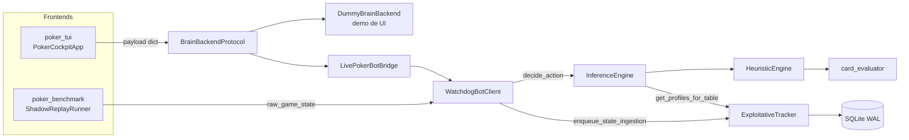
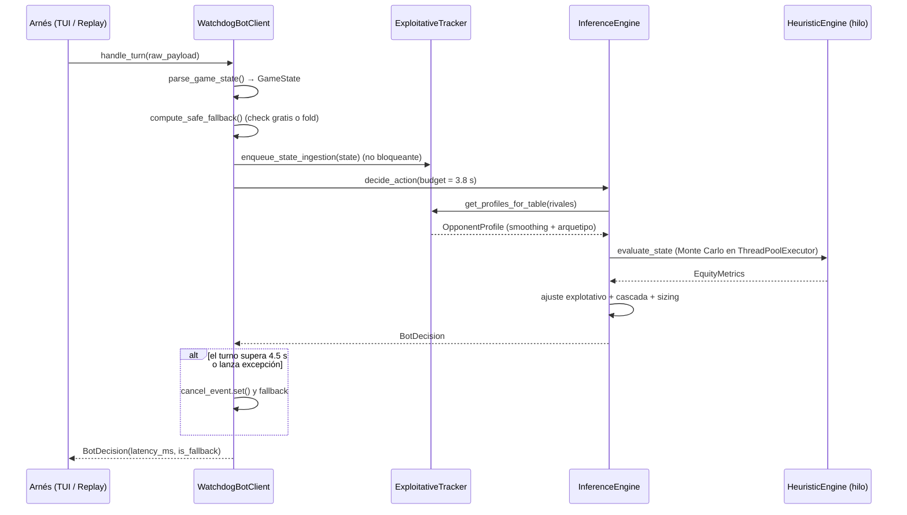

## Arquitectura

El sistema son **un bot** y **dos arneses de simulación** que le hablan por el
mismo contrato. El bot no sabe si la partida es real, manual o un replay: recibe
un `GameState` y devuelve un `BotDecision`.

### 1. Componentes

| Componente | Archivo | Responsabilidad |
|---|---|---|
| `WatchdogBotClient` | `poker_bot/network_watchdog.py` | Parsear el JSON de mesa, orquestar el turno, imponer el timeout y devolver el fallback. |
| `InferenceEngine` | `poker_bot/inference_engine.py` | Elegir la acción: combina equity + perfil del rival + sizing. |
| `HeuristicEngine` | `poker_bot/heuristic_engine.py` | Matemática pura: Monte Carlo, pot odds, SPR, Chen score. Sin estado. |
| `ExploitativeTracker` | `poker_bot/exploitative_tracker.py` | Persistencia SQLite y perfilado (VPIP/PFR/AF/fold) con smoothing bayesiano. |
| `card_evaluator` | `poker_bot/card_evaluator.py` | Evaluar y comparar manos de 5–7 cartas. |
| `PokerCockpitApp` | `poker_tui/app.py` | Entrada manual del estado de mesa y presentación de la decisión. |
| `LivePokerBotBridge` | `poker_tui/backend_bridge.py` | Traducir el payload de la TUI a un turno del bot real. |
| `KaggleParquetLoader` | `poker_benchmark/parquet_loader.py` | Reconstruir snapshots cronológicos desde Parquet sin filtrar cartas futuras. |
| `ShadowReplayRunner` | `poker_benchmark/shadow_evaluator.py` | Pasar cada snapshot por el bot y agregar el informe. |

### 2. Contratos

#### Entrada: JSON de mesa → `GameState`

`WatchdogBotClient.parse_game_state()` acepta un diccionario con estos campos
(todos opcionales; los ausentes toman el valor por defecto indicado. Si se
envían `players` o `action_history`, cada elemento debe traer `player_id`). La
definición canónica está en `poker_bot/models.py`.

| Campo | Tipo | Semántica |
|---|---|---|
| `hand_id`, `table_id`, `hero_id` | str | Identificadores; por defecto `hand_0`, `table_0`, `hero`. |
| `street` | str | `PREFLOP` / `FLOP` / `TURN` / `RIVER`. Si no es válido, cae a `PREFLOP`. |
| `hole_cards` | list[str] | Cartas propias, p. ej. `["Ah", "Kd"]`. |
| `community_cards` | list[str] | Board visible en esta calle (0, 3, 4 o 5 cartas). |
| `pot` | int | Bote **antes** de la acción actual. |
| `to_call` | int | Fichas que faltan para igualar la apuesta actual. `0` = puede checkear. |
| `min_raise` | int | Subida mínima legal. |
| `max_raise` | int | Apuesta máxima (normalmente el stack efectivo del héroe). |
| `small_blind`, `big_blind` | int | Ciegas de la mano. |
| `dealer_seat` | int | Asiento del botón. |
| `players` | list[dict] | `player_id`, `seat`, `stack`, `current_bet`, `is_active`, `is_all_in`, `position`. |
| `action_history` | list[dict] | `player_id`, `street`, `action_type`, `amount`, `pot_before`, `to_call_before`. |

El loader de Parquet y el bridge de la TUI construyen exactamente este JSON;
así el bot se prueba en los dos modos sin adaptadores distintos.

#### Salida: `BotDecision`

| Campo | Tipo | Semántica |
|---|---|---|
| `action` | `ActionType` | `FOLD`, `CHECK`, `CALL`, `RAISE`, `ALL_IN`. |
| `amount` | int | Fichas comprometidas por la acción (en `RAISE`, el tamaño objetivo). |
| `reasoning` | str | Etiqueta legible del motivo (`VALUE_BET`, `WATCHDOG_TIMEOUT_EXCEEDED`, ...). |
| `is_fallback` | bool | `True` si la decisión la tomó el watchdog y no la inferencia. |
| `latency_ms` | float | Tiempo total del turno. |

`DummyBrainBackend` devuelve un `BrainResponse` equivalente para la TUI, con
`equity` y `pot_odds` añadidos para el panel.

### 3. Flujo de un turno

Detalle de cada paso algorítmico en [`algoritmos.md`](algoritmos.md#a-orden-de-aplicación-del-pipeline).

### 4. Pipeline de decisión (resumen)

| Paso | Qué hace | Dónde |
|---|---|---|
| 1 | Identifica al rival principal (último agresor o primer oponente activo). | `InferenceEngine._identify_primary_opponent` |
| 2 | Pide equity Monte Carlo + pot odds + SPR + EV. | `HeuristicEngine.evaluate_state` |
| 3 | Ajusta umbrales según arquetipo y confianza. | `InferenceEngine.compute_exploitative_adjustments` |
| 4 | Aplica la cascada: all-in → value → bluff → call/fold → check. | `InferenceEngine._resolve_action` |
| 5 | Dimensiona la apuesta y la acota a `[min_raise, max_raise]`. | `InferenceEngine.calculate_optimal_bet_sizing` |

Los umbrales concretos están en
[`algoritmos.md § B`](algoritmos.md#b-constantes-y-umbrales).

### 5. Los dos flujos de simulación

#### Manual: TUI → bot

1. La TUI mantiene el estado en reactivos (`hand_cards`, `board_cards`, `pot_size`, ...).
   Los palos admiten notación española (`e`/`c`/`d`/`t`) y se canonizan a
   `s`/`h`/`d`/`c` antes de salir.
2. Ctrl+Enter / F9 ensambla `current_payload` y llama a `backend.evaluate_table_state`.
3. Con `LivePokerBotBridge` (activo con `--live`), ese payload se convierte en un
   `GameState` sintético y se pasa por `handle_turn`; con `DummyBrainBackend`
   (por defecto) se usa una heurística de demo para probar colores y reactividad
   sin cargar el motor.
4. La respuesta se pinta en `DecisionBanner`.

#### Shadow replay: Parquet → bot → informe

1. `KaggleParquetLoader.iter_snapshots()` lee `matches`, `hands` y `actions`.
2. Reconstruye el estado **acción a acción**: pot acumulado, `to_call` por calle,
   board visible según la fase y stacks restantes.
3. Emite un `DecisionSnapshot` por cada acción que no sea ciega forzada, con la
   acción real del agente LLM y el resultado de la mano.
4. `ShadowReplayRunner` llama a `handle_turn` con el mismo contrato que la TUI.
5. `ShadowBenchmarkReport` agrega latencias, matriz LLM vs bot, *good folds*,
   *value raises* y perfiles.

La invariante del replay es **no filtrar el futuro**: en preflop el board va
vacío, en flop solo 3 cartas, y las cartas del rival nunca entran en el estado.
Ver [`datos.md § 3`](datos.md#3-reconstrucción-de-snapshots).

### 6. SLA y watchdog

| Parámetro | Valor | Efecto |
|---|---|---|
| `hard_timeout` | 4.5 s | `asyncio.wait_for` corta el turno completo. |
| `soft_timeout` | 3.8 s | Presupuesto que recibe el Monte Carlo por lote. |
| Fallback | `CHECK` si `to_call == 0`, si no `FOLD` | Se calcula antes de inferir, en <0.1 ms. |
| Executor | `ThreadPoolExecutor(max_workers=2)` | Aísla el Monte Carlo del event loop. |
| Cancelación | `threading.Event` | El bucle Monte Carlo la consulta en cada lote. |

El bot nunca debe superar el límite de 5 s de la mesa; los 0.5 s de margen
absorben la red.

### 7. Puntos de extensión

- **Sala real:** implementar `TransportAdapter` (`receive_game_state` / `send_action`)
  y pasarlo a `create_bot`. El resto del bot no cambia.
- **Otro frontend:** implementar `BrainBackendProtocol.evaluate_table_state` y
  pasarlo a `PokerCockpitApp(backend=...)`.
- **Otro dataset:** producir el mismo JSON de mesa y alimentar `handle_turn`
  directamente; el replay solo necesita `DecisionSnapshot`.

### 8. Glosario

| Término | Significado |
|---|---|
| **VPIP** | % de manos en las que el jugador pone dinero voluntariamente preflop. |
| **PFR** | % de manos en las que sube preflop. |
| **3-bet** | Tercera subida preflop (la primera es la ciega, la segunda el *raise*). |
| **AF** | Factor de agresividad postflop: `bets+raises / calls`. |
| **WTSD** | % de manos que llegan a showdown habiendo visto flop. |
| **SPR** | Stack-to-Pot Ratio: stack efectivo dividido por el bote. |
| **Pot odds** | Coste del call dividido por el bote final; equity mínima para pagar. |
| **Arquetipo** | Etiqueta de estilo del rival: NIT, TAG, LAG, STATION, MANIAC. |
| **Shadow replay** | Reproducir decisiones históricas contra el bot, sin jugar en vivo. |

### 9. Decisiones y límites conocidos

- **SQLite WAL + cola async.** Las escrituras no deben bloquear el turno. El
  precio es que `background_writer_loop()` debe estar corriendo; en el replay
  **no se arranca**, así que el informe muestra los priors y no perfiles
  aprendidos (ver [`datos.md § 5`](datos.md#5-límites-conocidos)).
- **Monte Carlo acotado por tiempo.** Se prefiere una estimación imprecisa a
  perder el turno. El techo real es `soft_timeout`, no `default_iterations`.
- **Fallback check/fold.** Es la acción que nunca empeora la situación: gratis
  si se puede, retirada si hay que pagar. Ante un timeout no se especula.
- **Un solo bot, dos arneses.** Cualquier cambio en el contrato de entrada
  afecta a TUI, replay y tests a la vez; por eso el contrato está congelado en
  `models.py`.
